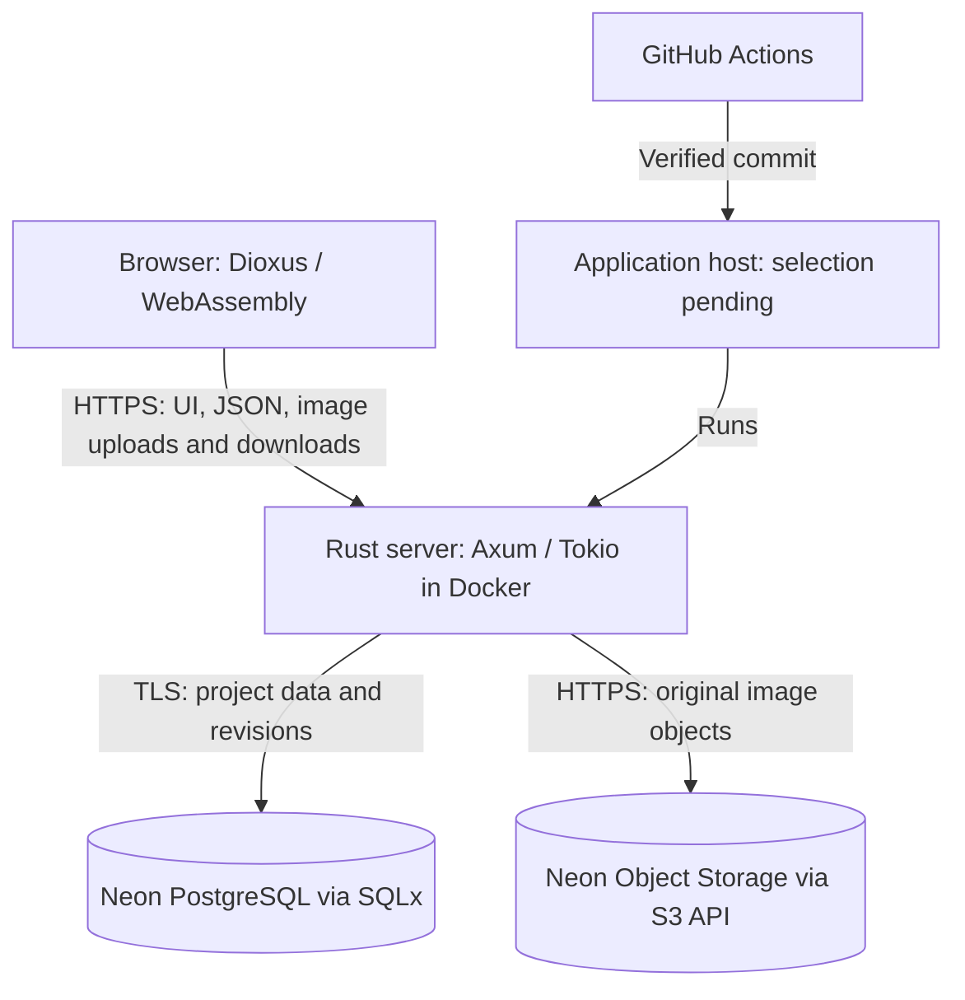

# Hosting and storage target architecture

Date: 2026-10-15
Status: Prototype storage implementation available; live Neon validation and deployment pending.

## Goals and constraints

The user selected Neon for PostgreSQL and image storage after reviewing hosting
options. Hosting must be free within the selected quotas and must not require a
payment card, including a card supplied only for verification. Project data and
images must survive application restarts, idle suspension, and deployments.

Keep Rust, Dioxus, Axum, SQLx, and the Docker deployment model. Retain a practical
path to another provider through standard PostgreSQL and supported S3 operations.
Render Free is selected for the native Rust application. The user reports that
Render and Neon are set up (2026-10-19); runtime configuration and live
compatibility still need verification. See the
[activation guide](../development/render-deployment.md).

## Current implementation versus target

The [current prototype](overview.md) now stores a revisioned workspace JSONB
document and upload catalog in PostgreSQL, with private images in S3-compatible
object storage. Abandoned-upload reconciliation is implemented. The original
local-storage rig was never used; initialize a fresh PostgreSQL workspace rather
than importing legacy data. See [setup and recovery](../development/neon-storage.md).

This implements the storage transition for the four-panel spike, not the full
relational milestone. Live Neon compatibility and deployment activation
remain pending. The earlier disposable
Render configuration in PR #1 has not been merged into `main` and is superseded
by the current provider-independent Docker/CI verification setup.

| Component | Target responsibility |
| --- | --- |
| Dioxus / WebAssembly browser UI | Edit and display project data; send requests to the Rust API |
| Rust / Axum / Tokio server | Serve the frontend and API; validate edits and images; enforce access; coordinate storage |
| SQLx with PostgreSQL on Neon | Persist structured project data, revisions, image identities, and object keys |
| Neon Object Storage | Persist original images and retained alternatives outside the database |
| Docker application host | Run the Rust process with disposable local storage; Render Free selected |
| GitHub Actions | Verify the application, then deploy the verified source revision to the selected host |

One Rust service initially serves both frontend and API on the same origin.
It needs no persistent local disk.
Local temporary files and caches may be lost at any time without losing saved
work. The browser is not the durable storage authority.

## Data ownership and request flows

PostgreSQL holds project structure, editable content, associations, layout and
crop settings, selected images, and revisions. Image records identify immutable
objects by stable keys, not expiring signed URLs or provider-specific public
URLs. Image bytes belong in object storage, not database rows.

For the prototype, retaining the revisioned workspace snapshot as JSONB
is acceptable. This does not implement the complete relational milestone model;
its schema and migrations need a separate implementation plan.

### Edits

The browser submits an edit with its expected revision. The server validates it,
then uses a database transaction and conditional revision update to reject stale
writes. Validation that depends on stored state must occur within that transaction.
A process-local mutex cannot provide correctness across restarts or multiple
server instances. A save is reported as successful only after the commit.

### Image uploads

The browser initially uploads through the existing Rust API. The server retains
the prototype's format, byte-size, dimension, and decoding limits, assigns a
unique object key, and uploads the validated original to a private bucket.
It then commits the image record and workspace revision in PostgreSQL. Replacing
the selected image retains previous alternatives, as required by the product.

PostgreSQL and object storage do not share an atomic transaction. A failed
database commit must not report a saved image: attempt to remove the newly
uploaded object, and provide reconciliation for orphaned uploads after failures
or crashes. An ambiguous upload result must be checked before a retry creates
another image. Never remove objects still referenced by saved records.

### Image reads and access

Initially keep stable application image URLs: the server resolves the image ID
to an object key and streams the object after checking access. Browser code
never receives database credentials or bucket write credentials. Thumbnails can
be added later to reduce traffic; they must not replace the retained originals.

The prototype now uses a long personal HTTP Basic password over HTTPS and
same-origin checks for writes. All UI, workspace, and image routes require
authentication; only process liveness is public, without querying the database.
This is one owner workspace, not
multi-user/project authorization. Buckets must also remain private.

## Free capacity and operational limits

The published Neon Free plan was checked on 2026-10-15:

| Resource | Published free allowance per project |
| --- | --- |
| PostgreSQL storage | 1 GB |
| Object storage | 5 GB |
| Database compute | 100 CU-hours per month |
| Public network transfer | 5 GB per month |

Neon states that its Free plan requires no payment card and has no time limit.
Object storage is available in Frankfurt, among other regions; choose a region
supporting both services, preferably near the eventual application host.
Recheck availability and terms when provisioning; quotas are not an unlimited
availability or backup guarantee.

The user's generated originals are typically 2–3 MB. Five decimal GB therefore
holds roughly 1,600–2,500 originals before thumbnails and other stored files.
Every retained alternative counts, and storage usage includes project branches.
At an average of 2.5 MB, 1,000 originals occupy about 2.5 GB.

The storage allowance is total retained capacity, not a fresh allowance every
month. Transfer and compute have separate monthly limits: repeatedly viewing
images can exhaust transfer before storage fills. Use pagination and eventually
thumbnails rather than loading all originals in gallery views.

Account setup must stay on the Free plan with no card or automatic paid upgrade.
Monitor usage and report quota or availability failures without discarding
unsaved edits or falsely acknowledging uploads. Idle services may need time to
wake. Connection pooling, bounded retries, and visible save outcomes must handle
temporary unavailability.

## Configuration and deployment

Keep database, TLS, bucket endpoint, region, bucket name, and credentials in
server-side configuration. Use a pooled PostgreSQL application connection and
an appropriate migration connection. Never embed secrets in the Wasm bundle,
Docker image, repository, logs, or documentation.

Keep build and verification independent of production credentials. CI should use
disposable PostgreSQL and object-storage test resources. Preserve the documented
formatting, tests, Clippy, and release builds. Retain the container startup
verification proposed in PR #1 and add storage integration checks as part of
the storage implementation.

PR verification uses disposable storage without production credentials. Once
configured, main runs explicitly migrate the schema with the verified image,
then request that exact commit through a scoped Render deploy hook. The
[activation guide](../development/render-deployment.md) lists the runtime
settings, two GitHub secrets, and opt-in variable. Render auto-deploy must be off
so it cannot bypass this sequence. Hook acceptance is distinct from a confirmed
live release; check Events and the authenticated application flow. Schema migrations must be
versioned, coordinated, and compatible with the deployed application; do not
run destructive migrations implicitly on every process start.

## Recovery and portability

Durability across deploys does not replace backup. The approved
[project backup and restoration requirement](../requirements/project-backup.md)
still needs implementation: a self-contained export must contain structured
data and all referenced originals and alternatives. Short database restore
windows alone cannot recover the complete project and its images.

A database export and object inventory/copy must describe a consistent project
revision. Keep recovery copies outside the same Neon project and verify restore
before relying on the new storage. Provider credentials and signed URLs do not
belong in portable project archives.

Use ordinary PostgreSQL through SQLx and a small storage module using the S3
operations Neon supports. Neon implements a subset of S3, so required operations
must be integration-tested. Avoid coupling core project behavior to Neon-only
functions, triggers, branching, or authentication features.

Moving later should require migrating PostgreSQL data, copying objects while
preserving keys, updating server configuration, and changing the deploy target.
The browser UI and project model should not depend on the provider's hostname.

## Transition and remaining decisions

1. Specify database migrations, object-record mapping, failure recovery, and
   access protection in an implementation plan.
2. Implement PostgreSQL persistence and S3-compatible image storage; verify
   stale-write protection, upload failures, reads, and retained alternatives.
3. Initialize a fresh PostgreSQL workspace using the explicit schema migration
   command. No old workspace or images need importing (confirmed 2026-10-16).
4. Configure the selected Render Free service and GitHub deployment secrets;
   activate the implemented workflow and verify the live release.
5. Verify that saved edits and images survive a fresh container, a redeploy,
   and idle suspension without any local data volume.

Open decisions include live Neon validation,
relational milestone schema, and backup execution/retention. This document
records the selected architecture; it does not authorize paid provisioning or
claim existing user data has been migrated, full backup is implemented, or a
live deployment is complete. Prototype access protection and the schema migration
command are implemented; accounts and production data are not touched.

## Sources

- [Neon plans, quotas, and no-card Free plan](https://neon.com/pricing)
- [Neon Object Storage, regions, limits, and S3 API](https://neon.com/docs/storage/overview)
- [Render Free service limitations](https://render.com/docs/free)
